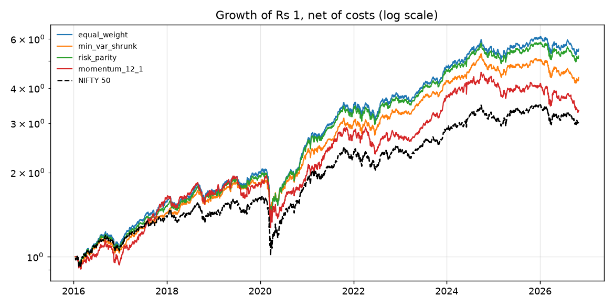
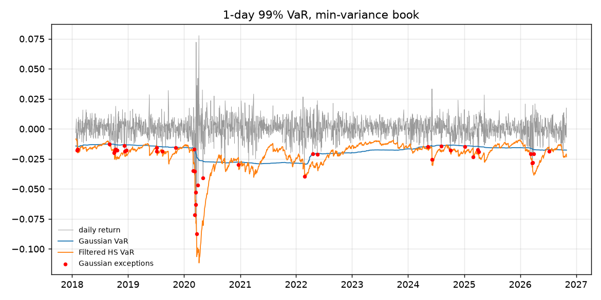

# FinCore Analytics

Tooling for three jobs a finance and research desk does every week, built around Indian markets and accounting conventions:

1. **Portfolio research and market risk.** Walk-forward backtests of portfolio construction rules on 25 NIFTY 50 stocks with NSE transaction costs, four VaR models with regulatory backtests, stress replays of Indian market episodes, Euler risk decomposition and Carino-linked Brinson attribution.
2. **Bank reconciliation.** A multi-pass ledger-to-bank matcher that works in integer paise, gates inputs on data quality, classifies every break, writes an auditable run (manifest with input hashes, SQLite database, MIS report built from SQL).
3. **Valuation.** An integrated three-statement model with a revolver and the interest circularity solved explicitly, a DCF with mid-year discounting and a value-driver terminal value, scenarios, a WACC x growth grid, trading comps and a reverse DCF.

Everything is reproducible offline: the price snapshot is committed, the reconciliation data is seeded, and every number below comes from `reports/`, which the CLI regenerates.

```
$ fincore var
min_var_shrunk: filtered_hs 99% 1-day VaR for the next session 2.33% (ES 2.67%)
backtest: 24 exceptions in 2159 days (expected 21.6), Kupiec p=0.609, Christoffersen p=0.269, zone=green

$ fincore recon-demo --seed 7
ledger 4076 rows, bank 4032 rows, 4052 true links
naive amount+date : precision 0.9405 recall 0.7535
fincore matcher   : precision 1.0000 recall 1.0000 break-label accuracy 1.0000
```

## 1. Research and risk

Daily adjusted closes for 25 NIFTY 50 constituents and the index, Jan 2015 to Oct 2026 (`data/nse_prices.csv`, refreshed by `scripts/fetch_nse.py`). Six construction rules are rebalanced monthly from a 252-day window.

The backtester decides at the close of day *d*, trades at the close of *d+1* and earns returns from *d+2*. Weights drift between rebalances and turnover is measured against the drifted book. Costs are the actual delivery-segment charges (STT 0.1% each side, stamp duty 0.015% on buys, exchange and SEBI fees with GST) plus square-root market impact sized against lagged 20-day traded value. A test corrupts every price after a decision date and checks the decision doesn't change.



| strategy | CAGR net | CAGR gross | vol | Sharpe | max DD | turnover/yr | cost/yr |
|---|---|---|---|---|---|---|---|
| equal_weight | 17.56% | 17.82% | 15.45% | 0.72 | -34.43% | 0.33 | 0.22% |
| inverse_vol | 16.95% | 17.24% | 14.97% | 0.70 | -33.58% | 0.37 | 0.24% |
| min_var_sample | 14.99% | 16.06% | 13.48% | 0.64 | -26.59% | 1.08 | 0.92% |
| min_var_shrunk | 14.99% | 15.93% | 13.51% | 0.64 | -26.99% | 0.99 | 0.81% |
| risk_parity | 16.93% | 17.24% | 14.73% | 0.71 | -32.42% | 0.39 | 0.26% |
| momentum_12_1 | 12.07% | 17.14% | 17.90% | 0.37 | -34.77% | 2.74 | 4.42% |
| NIFTY 50 price index | 11.18% | | 16.13% | 0.35 | -38.44% | | |

What the numbers say, including the uncomfortable parts:

- **Survivorship bias.** The universe is today's index members, so every strategy beats the index partly because the losers were removed in hindsight. The index is also a price index without dividends (roughly 1.2 to 1.5 points a year). Read the table across strategies, not against NIFTY.
- **Costs decide momentum.** 12-1 momentum earns 17.1% gross and 12.1% net at Rs 500 crore. The capacity run shows it falling to 3.4% at Rs 5,000 crore, while risk parity barely moves (17.1% to 16.5%).
- **Shrinkage barely matters here.** With a 10% position cap, sample and Ledoit-Wolf min-variance books are almost identical. The cap is already doing the regularising. Shrinkage cuts turnover by about 8%, which is its main real effect.
- **Min-variance buys drawdown protection, not return.** It cuts the worst drawdown by about 7 points and beta to 0.74, and gives up 2.6 points of CAGR against equal weight. The attribution in the report pins most of that on the overweight in consumer staples and utilities.

### VaR backtest

1-day 99% VaR on the min-variance book, re-estimated daily from the previous 500 days:

| model | exceptions (expected 21.6) | Kupiec p | Christoffersen p | Basel zone | avg VaR |
|---|---|---|---|---|---|
| historical | 25 | 0.472 | 0.294 | green | 2.50% |
| parametric (Gaussian) | 40 | 0.000 | 0.042 | yellow | 1.88% |
| Cornish-Fisher | 22 | 0.930 | 0.222 | green | 3.16% |
| filtered historical simulation | 24 | 0.609 | 0.269 | green | 2.13% |



The Gaussian model fails on both counts: almost twice the expected exceptions, and they cluster (Christoffersen p = 0.04). Cornish-Fisher passes by being conservative, holding 48% more VaR than filtered HS. Filtered HS (EWMA-standardised residuals rescaled by today's volatility) passes both tests with the second-lowest average VaR, so it is the CLI default.

The report also covers sector-level component VaR, a market/residual variance split, a replay of six Indian episodes (demonetisation, IL&FS, COVID, the 2022 rate hikes, Hindenburg-Adani, the 2024 election result) and Brinson-Fachler attribution against equal weight. The Carino-linked effects sum to the compound excess return exactly, and a test checks that unlinked summation does not.

## 2. Bank reconciliation

Real ledgers can't be published, so the matcher is measured on a seeded generator that injects nine kinds of break and keeps a truth table: timing lags, bank charges net of GST, transposed digits, split receipts, bulk receipts covering several invoices, duplicate bookings, uncleared cheques, unbooked bank entries and missing UTRs. It also adds the noise that makes real statements hard: bank narrations that spell names differently ("PVT LTD" vs "PRIVATE LIMITED"), cut names off at 20 characters, the odd typo, and retainers of the same amount every few weeks.

The passes run from strict to loose, and each record is consumed once: exact UTR and amount, split, same UTR with a different amount (transposition, bank charges or an unexplained difference), no UTR (amount + fuzzy counterparty + nearest date), aggregate (exact subset sum over a counterparty's open items), then duplicates. Every match stores the rule and the evidence.

| matcher, 5 seeds x ~4,000 rows each | pair precision | pair recall |
|---|---|---|
| naive amount + date (the spreadsheet approach) | 0.933 to 0.941 | 0.733 to 0.756 |
| fincore, exact counterparty names | 0.9998 to 1.0 | 0.993 to 0.996 |
| fincore, fuzzy counterparty names | 0.9998 to 1.0 | 0.9998 to 1.0 |

The naive matcher's 6% false matches are the dangerous number: those items look reconciled and are not. Building the generator turned up two problems a clean test set would have hidden. The 20-character cut often lands inside the legal suffix ("AARAV LOGISTICS PRIV"), so a trailing suffix fragment is now stripped. And a careless " CO" to " COMPANY" substitution in my own generator was turning COFFEE into COMPANYFFEE. The remaining misses on seed 11 are pairs of byte-identical duplicate bookings, where either entry could be called the original.

`fincore recon` runs the full pipeline on CSV extracts:

- **Quality gates.** Duplicate keys, missing required fields and non-integer paise block the run. Out-of-period dates, non-INR rows and missing references only lower the quality score. Amounts are read as strings and parsed explicitly, because `float("1250.10") * 100` is where paise go missing.
- **Run directory.** `manifest.json` (input SHA-256s, row counts, check results, git revision), `recon.sqlite` (ledger, bank, matches, match_lines, breaks), `matches.csv`, `breaks.csv` with age and suggested action, and `mis.md` built from the SQL in `fincore/recon/sql/`. See [reports/recon_mis.md](reports/recon_mis.md).

## 3. Valuation

`fincore value examples/valuation/example_industrials.toml` builds the memo in [reports/valuation_exind.md](reports/valuation_exind.md). The company is illustrative (made-up numbers shaped like an Indian mid-cap industrial, anonymised peers), and the TOML format takes a real annual report.

- The balance sheet is checked to balance every year. The cash flow statement is tested to tie to the change in cash.
- Interest on average debt and cash makes the model circular. It is solved by fixed-point iteration and converges in 8 iterations.
- The revolver sweeps to keep minimum cash. If it is fully drawn and cash would still go negative, the model raises `FundingGapError` instead of showing negative cash the way a spreadsheet would. That case turned up while writing the tests.
- The terminal value uses the value-driver formula, NOPAT(1 - g/RONIC)/(WACC - g), so terminal reinvestment is tied to growth. A test checks that growth adds nothing when RONIC equals WACC.
- Comps and DCF are put side by side, and the reverse DCF states the gap as the perpetual growth the peers' multiples imply (7.7% here, against 5.5% in the base case).

## Usage

```bash
pip install -e ".[dev]"

fincore research                        # reports/research.md + charts (about 1 minute)
fincore var --method filtered_hs        # next-day VaR and its backtest
fincore recon --ledger examples/recon/ledger.csv --bank examples/recon/bank.csv --as-of 2026-06-30
fincore recon-demo --seed 11            # generate, match and score
fincore value examples/valuation/example_industrials.toml

python scripts/fetch_nse.py             # refresh the price snapshot
pytest -q                               # 65 tests
```

## Layout

```
fincore/
  data/        price snapshot loader, universe and sectors
  risk/        VaR/ES models, Kupiec/Christoffersen/Basel backtests, stress, component VaR
  portfolio/   covariance (sample, EWMA, Ledoit-Wolf), optimisers, metrics, attribution
  research/    walk-forward engine, NSE cost model, strategies, research report
  recon/       generator, matcher, quality gates, pipeline, SQL for the MIS
  valuation/   three-statement model, DCF, comps, memo
tests/         65 tests: closed forms, reference implementations, no-lookahead, recon accuracy
```

The tests check results against independent references wherever one exists: the Gaussian VaR/ES closed form, a hand-computed Kupiec statistic, Basel traffic-light boundaries, a loop-by-loop transcription of Ledoit and Wolf's `covCor.m`, the growing-perpetuity formula for the DCF, and the equal risk contributions that risk parity should produce.

## Limitations

- Survivorship bias in the universe (above). A point-in-time constituent list would fix it.
- Transaction costs assume execution at the closing price. Real orders above a few percent of ADV would be worked over several days.
- The reconciliation figures come from synthetic data. They measure the matcher's logic against known answers, not how it would do on a particular bank's statement formats.
- The valuation example is illustrative and not investment advice.

MIT licence.
